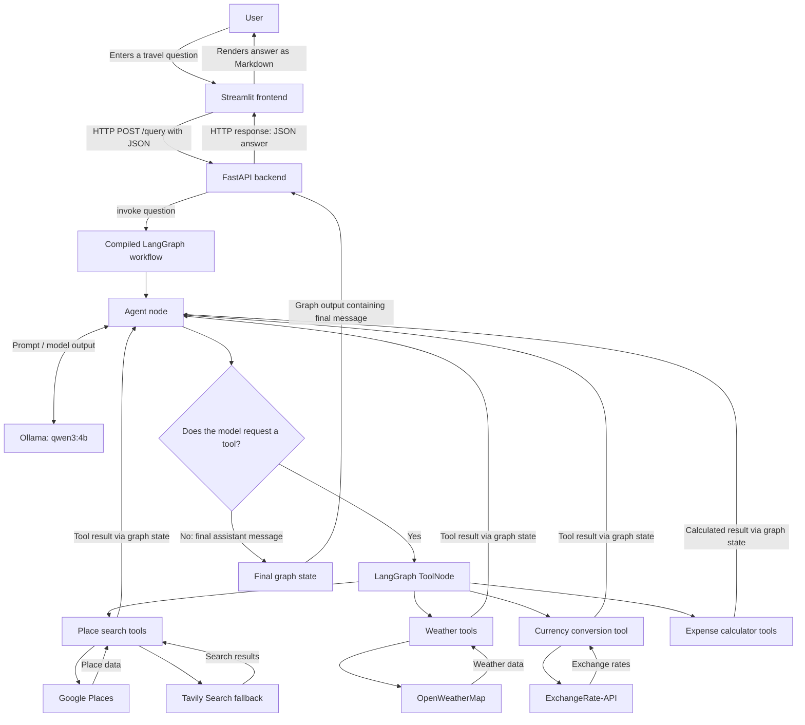

# 🗺️ AI Trip Planner Agent

An AI-assisted travel planning application built with **Python, LangGraph, LangChain, Ollama, FastAPI, and Streamlit**. It accepts a travel-related question, uses a locally hosted language model to coordinate available tools, and returns a travel plan or travel-related answer in Markdown.

The agent can search for attractions, restaurants, activities, and transportation options; retrieve current weather and forecast data; convert currencies; and calculate trip-expense estimates.

> **Important:** This application provides AI-generated travel guidance, not confirmed bookings or guaranteed prices. Validate hotel rates, restaurant prices, attraction opening hours, weather conditions, transport schedules, visa requirements, and other time-sensitive details with official or trusted providers before making travel decisions.

## Contents

- [Features](#features)
- [How it works](#how-it-works)
- [Architecture](#architecture)
- [Technology stack](#technology-stack)
- [Project structure](#project-structure)
- [Prerequisites](#prerequisites)
- [Environment configuration](#environment-configuration)
- [Installation](#installation)
- [Run the application](#run-the-application)
- [API reference](#api-reference)
- [Available tools](#available-tools)
- [Configuration reference](#configuration-reference)
- [Troubleshooting](#troubleshooting)
- [Security notes](#security-notes)
- [License](#license)

## Features

- **Natural-language travel planning:** Ask for a trip plan using a conversational prompt, such as “Plan a 5-day trip to Goa.”
- **Day-by-day itinerary generation:** The system prompt asks the agent for a detailed itinerary, attractions, restaurants, activities, transport options, weather information, and a cost breakdown.
- **Popular and offbeat options:** The prompt instructs the model to consider both popular tourist locations and less conventional places around the destination.
- **Place research:** Search for attractions, restaurants, activities, and transportation information using Google Places, with Tavily Search as a fallback when the Google lookup raises an exception.
- **Weather information:** Retrieve current weather and forecast data through OpenWeatherMap.
- **Currency conversion:** Convert an amount between supported currencies using ExchangeRate-API.
- **Expense calculations:** Calculate a hotel-cost estimate, sum expense values, and estimate a per-day budget using supplied numbers.
- **Local language model:** Use Ollama with the configured `qwen3:4b` model for local language-model inference.
- **Agent/tool workflow:** Use LangGraph to coordinate the LLM and registered tools.
- **REST API:** Expose the travel assistant through a FastAPI `POST /query` endpoint.
- **Web interface:** Submit questions through the Streamlit frontend and view the generated answer.
- **Markdown export helper:** A helper function is available to save a travel plan to a timestamped Markdown file; it is not currently wired to a button in the Streamlit interface or to the API endpoint.

Some features depend on valid API credentials, internet access, service quotas, and the model correctly selecting tools. There is no dedicated hotel-booking or live hotel-price integration in the current implementation, so hotel recommendations and prices in the generated answer may be estimates or model-generated suggestions rather than verified offers.

## How it works

1. A user enters a question in the Streamlit interface.
2. Streamlit sends the question as JSON to the FastAPI backend at `POST /query`.
3. When FastAPI starts, its lifespan handler constructs the LangGraph agent and stores the compiled graph in application state.
4. The graph sends the system prompt and user question to the Ollama model.
5. If the model requests a registered tool, LangGraph executes the tool and returns its result to the agent workflow.
6. The model uses available results to produce a final response.
7. FastAPI returns the response in JSON, and Streamlit displays it as Markdown.

## Architecture




**Response path:** Ollama returns its model output to the LangGraph agent node. LangGraph checks whether the model requested a tool; if so, the tool executes and its result is fed back into the agent loop. When the graph finishes, `main.py` extracts the final message and returns `{"answer": final_output}` as the HTTP response to Streamlit. Ollama does not send the HTTP response directly to FastAPI.

### Main components

| Component | Responsibility |
|---|---|
| `streamlit_app.py` | Collects the user question, calls the API, and renders the response. |
| `main.py` | Defines the FastAPI application, request model, startup lifecycle, logging, CORS middleware, and `POST /query`. |
| `agent/agentic_workflow.py` | Loads the model, registers tools, and builds the LangGraph workflow. |
| `prompt_library/prompt.py` | Defines the system prompt and the expected style and content of travel plans. |
| `utils/model_loader.py` | Reads the configured model name and initializes `ChatOllama`. |
| `utils/config_loader.py` | Loads YAML configuration from `config/config.yaml`. |
| `tools/` | Adapts place, weather, currency, and expense functions into LangChain tools. |
| `utils/` | Implements external service wrappers, arithmetic calculations, and a Markdown export helper. |
| `config/config.yaml` | Stores the configured LLM provider, model name, and Ollama URL. |

## Technology stack

| Technology | Use in this project |
|---|---|
| Python | Application language |
| Ollama | Local LLM runtime |
| Qwen 3 4B (`qwen3:4b`) | Configured language model |
| LangChain | LLM and tool integrations |
| LangGraph | Agent workflow and tool execution |
| FastAPI | REST API backend |
| Pydantic | API request validation |
| Streamlit | User interface |
| Google Places integration | Search for places and local points of interest |
| Tavily Search | Web-search fallback for place research |
| OpenWeatherMap | Current weather and forecast data |
| ExchangeRate-API | Currency conversion rates |
| `python-dotenv` | Loading environment variables from `.env` |
| `requests` | HTTP requests from the frontend and service utilities |
| PyYAML | Reading YAML configuration |

## Project structure

```text
trip_planner_agent/
├── agent/
│   └── agentic_workflow.py       # LangGraph workflow and registered tools
├── config/
│   └── config.yaml               # Ollama model configuration
├── notebook/
│   └── experiments.ipynb         # Notebook for experiments
├── prompt_library/
│   └── prompt.py                 # Travel-planning system prompt
├── src/
│   └── trip_planner_agent/
│       └── __init__.py            # Package entry-point stub
├── tools/
│   ├── arithmetic_operation_tool.py
│   ├── currency_conversion_tool.py
│   ├── expense_calculator_tool.py
│   ├── place_search_tool.py
│   └── weather_info_tool.py
├── utils/
│   ├── config_loader.py
│   ├── currency_converter.py
│   ├── expense_calculator.py
│   ├── model_loader.py
│   ├── place_info_search.py
│   ├── save_to_document.py
│   └── weather_info.py
├── .env.example                 # Safe template for required API keys
├── .gitignore                    # Excludes the real .env file
├── .python-version               # Declares Python 3.14
├── LICENSE                       # MIT License
├── main.py                       # FastAPI backend
├── pyproject.toml                # Project/build metadata
├── requirements.txt              # Application dependencies
├── setup.py                      # Legacy setuptools configuration
├── streamlit_app.py              # Streamlit frontend
└── README.md
```

The `.env` file is created locally from `.env.example` and is intentionally not included in the repository archive because it can contain private API credentials.

`tools/arithmetic_operation_tool.py` contains additional arithmetic and Alpha Vantage helpers, but those functions are **not registered** in the current `GraphBuilder` workflow. The active expense calculator tools are defined in `tools/expense_calculator_tool.py`.

## Prerequisites

1. **Python 3.14:** The repository's `.python-version` and `pyproject.toml` specify Python 3.14 or later. Use a Python version supported by the installed dependency versions. If installation fails, check dependency compatibility and align the project metadata before changing Python versions.
2. **Ollama:** Install Ollama and ensure its local service is running.
3. **Model:** Download the configured model:
   ```bash
   ollama pull qwen3:4b
   ```
4. **External API credentials:** Obtain API keys for the services you want to use (Google Places, Tavily Search, OpenWeatherMap, and ExchangeRate-API).
5. **Internet access:** External search, place, weather, and currency requests require network connectivity.

The model must fit your machine's memory and hardware. Performance depends on the model, system resources, and the latency of external APIs.

## Environment configuration

A template named [`.env.example`](.env.example) is included in the repository. It documents the environment variables needed by the external services without publishing anyone's private credentials.

Create your local `.env` file by copying the template from the project root (the directory containing `main.py`):

**Windows PowerShell**

```powershell
Copy-Item .env.example .env
```

**Linux / macOS**

```bash
cp .env.example .env
```

Then open `.env` and replace the empty values with your own API keys. The template starts with empty values, so external API features will not authenticate until you add valid credentials.

```dotenv
OPENWEATHERMAP_API_KEY="your_openweathermap_api_key"
EXCHANGE_RATE_API_KEY="your_exchange_rate_api_key"
GPLACES_API_KEY="your_google_places_api_key"
TAVILY_API_KEY="your_tavily_api_key"
```

### API-specific notes

- **Google Places:** Enable the relevant Google Maps Platform API in the correct cloud project and check billing requirements, API-key restrictions, and quotas. A key by itself does not guarantee that a request is authorized.
- **Tavily Search:** Use the exact environment variable name `TAVILY_API_KEY` (not `TAVILAY_API_KEY`), which is expected by the Tavily integration.
- **OpenWeatherMap:** The weather tools read `OPENWEATHERMAP_API_KEY`.
- **ExchangeRate-API:** The currency tool reads `EXCHANGE_RATE_API_KEY`.

The `.gitignore` file excludes `.env`, but you should still verify that it is not already tracked before publishing the repository. Commit `.env.example`, not your real `.env`. An `.env.example` file is a template only; Python's `load_dotenv()` loads `.env` by default, so copying the template to `.env` is necessary unless you change the code to load another filename. Never paste real API-key values into README files, issues, screenshots, or source control. If a key has been exposed publicly, revoke or rotate it with the provider.

## Installation

Run the commands from the project root—the directory that contains `main.py`, `requirements.txt`, and `config/`.

### Windows PowerShell

```powershell
py -3.14 -m venv .venv
.\.venv\Scripts\Activate.ps1
python -m pip install --upgrade pip
pip install -r requirements.txt
```

### Windows Command Prompt

```bat
py -3.14 -m venv .venv
.venv\Scripts\activate.bat
python -m pip install --upgrade pip
pip install -r requirements.txt
```

### Linux / macOS

```bash
python3.14 -m venv .venv
source .venv/bin/activate
python -m pip install --upgrade pip
pip install -r requirements.txt
```

The repository currently has multiple packaging definitions: `requirements.txt`, `setup.py`, `pyproject.toml`, and `uv.lock`. The application dependencies are listed in `requirements.txt`, whereas `pyproject.toml` lists only `pandas` and defines a `uv_build` backend. Keep these files aligned if you change the installation method. In particular, do not assume `uv sync` installs the complete application dependency set until `pyproject.toml` is updated and tested.

If an installation command fails, review the full error and confirm that the active Python version is compatible with the dependency versions. A clean virtual environment is recommended for troubleshooting.

## Run the application

Start Ollama, the API, and the frontend. Keep the backend and frontend running in separate terminals.

### 1. Start or verify Ollama

Check installed models:

```bash
ollama list
```

If necessary, download the configured model:

```bash
ollama pull qwen3:4b
```

Make sure Ollama is reachable at `http://localhost:11434`. The current model loader uses this URL directly.

### 2. Start the FastAPI backend

Activate the virtual environment, then run from the project root:

```bash
uvicorn main:app --reload --host 127.0.0.1 --port 8000
```

Useful URLs:

- API base URL: `http://127.0.0.1:8000`
- Interactive API docs: `http://127.0.0.1:8000/docs`
- OpenAPI schema: `http://127.0.0.1:8000/openapi.json`

The FastAPI lifespan handler initializes the agent at startup and stores the compiled graph in the application state. If agent initialization fails, the backend logs the startup exception and fails to start.

### 3. Start the Streamlit frontend

In a second terminal, activate the same virtual environment and run:

```bash
streamlit run streamlit_app.py
```

Open the local address shown in the terminal, usually `http://localhost:8501`.

The frontend currently uses a hard-coded backend address of `http://localhost:8000`. If you run the backend on a different host or port, update `BASE_URL` in `streamlit_app.py`.

### 4. Try a prompt

Examples:

- `Plan a 5-day trip to Goa for two people with a moderate budget.`
- `Create a 3-day itinerary for Munnar and estimate the daily expenses.`
- `Find popular attractions and restaurants in Jaipur.`
- `What is the current weather in Kochi?`
- `Convert 500 USD to INR.`

These are example questions. Tool selection is model-driven, and a request does not guarantee that every tool will be called or that every detail will be correct.

## API reference

### `POST /query`

Submits a travel question to the agent.

**Request body**

```json
{
  "question": "Plan a 5-day trip to Goa for two people."
}
```

The request is validated by the Pydantic `QueryRequest` model. The `question` field is a string.

**Example success response**

```json
{
  "answer": "A generated travel plan in Markdown..."
}
```

The answer is produced dynamically by the model; the value above is illustrative.

### Test with `curl`

```bash
curl -X POST "http://127.0.0.1:8000/query" \
  -H "Content-Type: application/json" \
  -d '{"question":"Plan a 3-day trip to Jaipur"}'
```

### Test with PowerShell

```powershell
$body = @{ question = "Plan a 3-day trip to Jaipur" } | ConvertTo-Json
Invoke-RestMethod -Uri "http://127.0.0.1:8000/query" -Method Post -ContentType "application/json" -Body $body
```

### Error behavior

If agent execution fails, the API logs the exception on the server and returns HTTP `500` with a generic detail message. Check the backend terminal for diagnostic logs. The API currently exposes only the `POST /query` endpoint; health checks and authentication have not been implemented.

## Available tools

The following tools are registered by `GraphBuilder` and exposed to the model through LangChain.

| Tool | Purpose | Service or calculation |
|---|---|---|
| `search_attractions(place)` | Search for attractions | Google Places; Tavily fallback on exception |
| `search_restaurants(place)` | Search for restaurants | Google Places; Tavily fallback on exception |
| `search_activities(place)` | Search for activities | Google Places; Tavily fallback on exception |
| `search_transportation(place)` | Search for local transport information | Google Places; Tavily fallback on exception |
| `get_current_weather(city)` | Retrieve current weather | OpenWeatherMap |
| `get_weather_forecast(city)` | Retrieve forecast entries | OpenWeatherMap |
| `convert_currency(amount, from_currency, to_currency)` | Convert an amount between currencies | ExchangeRate-API |
| `estimate_total_hotel_cost(price_per_night, total_days)` | Multiply nightly price by number of days | Local calculation |
| `calculate_total_expense(*costs)` | Sum supplied costs | Local calculation |
| `calculate_daily_expense_budget(total_cost, days)` | Calculate an average daily cost | Local calculation |

### Tool behavior and data quality

- **Place search fallback:** Tavily is attempted when a Google Places call raises an exception. Empty Google results may not trigger a fallback, and a Tavily request can also fail. Search snippets should be treated as research material rather than official booking data.
- **Weather:** Forecast requests specify metric units. The current-weather request does not specify a unit system, although the tool formats the returned temperature with a Celsius label. Verify this output before relying on it.
- **Currency:** The conversion depends on an external rate response and may exclude bank fees, provider margins, taxes, or transaction-specific rates.
- **Expenses:** The calculators operate on model-supplied numeric values. They do not independently verify hotel rates, taxes, meal costs, or transportation prices.
- **Hotel information:** The active tool list does not include a dedicated hotel search or booking-price tool. Hotel recommendations or prices may therefore be estimates rather than live, verified offers.

## Configuration reference

| File or variable | Current behavior |
|---|---|
| `config/config.yaml` | Defines `provider`, `model_name`, and `base_url` for Ollama. |
| `llm.ollama.model_name` | Read by `utils/model_loader.py`; currently set to `qwen3:4b`. |
| `llm.ollama.base_url` | Present in YAML, but the loader currently hard-codes `http://localhost:11434` instead of reading this setting. |
| `GPLACES_API_KEY` | Read by the Google Places tool wrapper. |
| `TAVILY_API_KEY` | Expected by the Tavily integration; ensure the key uses this exact variable spelling. |
| `OPENWEATHERMAP_API_KEY` | Read by the weather tool wrapper. |
| `EXCHANGE_RATE_API_KEY` | Read by the currency conversion tool wrapper. |
| `BASE_URL` in `streamlit_app.py` | Hard-coded to `http://localhost:8000`. |
| `config/config.yaml` path | Loaded as a relative path; start the application from the project root. |

## Troubleshooting

### Ollama connection refused

- Ensure Ollama is installed and its service is running.
- Confirm the model is installed with `ollama list`.
- Verify the endpoint `http://localhost:11434` is reachable.
- Check available memory and system resources for `qwen3:4b`.

### Google Places returns `403 PERMISSION_DENIED`

- Confirm the request is authenticated with the correct `GPLACES_API_KEY`.
- Enable the relevant Google Maps Platform API in the correct cloud project.
- Check billing, quota, API restrictions, and key restrictions.
- Verify that the installed Google integration version supports the API and configuration you are using.
- Review the provider's detailed error response without printing secrets into logs.

### Tavily authentication fails

- Set the key as `TAVILY_API_KEY` in `.env`.
- Check for the typo `TAVILAY_API_KEY` and correct it.
- Restart the backend after changing environment variables.
- Confirm the Tavily account key is valid and has not exceeded its usage allowance.

### Weather lookup fails or reports unexpected units

- Confirm `OPENWEATHERMAP_API_KEY` is present and valid.
- Check network access, provider quotas, and the city spelling.
- Note that the current-weather request does not explicitly request metric units, unlike the forecast request.

### Currency conversion fails

- Confirm `EXCHANGE_RATE_API_KEY` is set and valid.
- The current implementation appends a slash before the currency code even though the configured base URL already ends in a slash. This can create an invalid URL path; correct the URL construction in `utils/currency_converter.py` if the API request fails.
- Check the HTTP response and the requested currency code.

### Frontend cannot reach the API

- Start FastAPI before using Streamlit.
- Confirm the backend is listening on port `8000`.
- Verify `BASE_URL` in `streamlit_app.py` matches the backend address.
- Check the backend terminal for exceptions.

### Configuration file not found

The config loader uses the relative path `config/config.yaml`. Run Uvicorn from the project root or update the loader to resolve configuration paths relative to the source file.

### Dependency installation fails

- Use a clean virtual environment and the Python version specified by the project.
- Review `requirements.txt`, `pyproject.toml`, `setup.py`, and `uv.lock` for consistency.
- Remember that the current `pyproject.toml` does not list all application dependencies.
- Pin and test compatible dependency versions if the latest packages are incompatible.

### The agent does not use a tool

- Make the question specific and include a destination or relevant city.
- Check the applicable service credentials and quotas.
- Tool selection depends on the model; it may not invoke a tool for every request.
- Verify time-sensitive information independently.


## Security notes

- Never commit API keys, `.env`, passwords, tokens, or other secrets.
- Rotate credentials if they have been exposed.
- Do not expose the development server directly to the public internet.
- Restrict CORS, add request limits, and consider authentication before deployment.
- Avoid returning internal exception details to API clients; use server-side logs for diagnosis.
- Apply API-key restrictions and quotas with each external provider where available.
- Review the terms and privacy policies of external services before sending travel questions or other user-provided information.

## License

This project is licensed under the [MIT License](LICENSE).

Copyright (c) 2026 Sooraj K K.

You may use, copy, modify, merge, publish, distribute, sublicense, and sell copies of the software, subject to the conditions in the [LICENSE](LICENSE) file.
